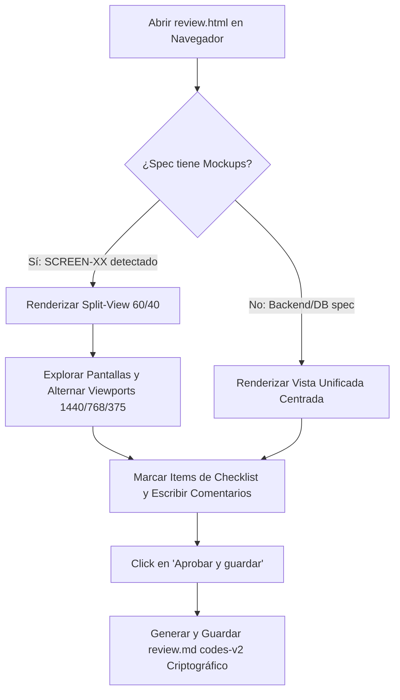

# Spec — AIDD 014: Mockup-First Spec Approval & Visual Verification Portal (Rule R6)

Produced during Step 2 (Align). Intake: NEW SPEC, evolving `007-aidd-review-html-close-gate` and `008-aidd-compact-review-direct-save` into an executive-grade, split-view approval portal with interactive mockup inspection, token compliance, and cryptographic task approval.

Risk: medium
<!-- medium: changes to review templates, review generator, and review items; strict CSP compliance and zero-regression policy -->

## Minimum Requirements Checklist (fill before Step 3 starts)

| Question | Answer | Source | If unanswered |
|---|---|---|---|
| Which module/area of the system? | AIDD review & approval engine: `skill/templates/review.html`, `adapters/dot-aidd/templates/review.html`, `skill/scripts/aidd_review.py`, `skill/scripts/aidd_review_items.py` | repo — skill/scripts/aidd_review.py:1 | → Step 2 align question |
| New development or modification of something existing? | Modernization of the `review.html` portal: adds split-view interactive mockup inspector, executive KPI cards, viewport switchers and component-level highlight while maintaining 100% cryptographic compatibility with codes-v2 and R6 approval | repo — skill/templates/review.html:1 | → Step 2 align question |
| Does it involve an external service, API, or integration? | No: stdlib-only Python, 100% self-contained offline HTML/CSS/JS, strict CSP `default-src 'none'; img-src 'self' data:; style-src 'unsafe-inline'; script-src 'sha256-...'` | repo — skill/templates/review.html:6 | → Step 2 align question |
| Who is requesting it? (role/profile, not necessarily the name) | Executive Sponsor & Senior Software Architect | repo — skill/scripts/aidd_review.py:1 | → Step 2 align question |
| Dependencies on other modules or active developments? | Specs 007 (`aidd_review`), 008 (`review.html` compact format `codes-v2`), and 009 (mirror parity between `skill/` and `adapters/dot-aidd/`) | repo — specs/008-aidd-compact-review-direct-save/spec.md:1 | → Step 2 align question |
| Business objective (1 sentence — what it achieves and why) | Transform spec approval from a text-only checklist into an interactive visual portal where the reviewer inspects mockups and components side-by-side with task planning before granting R6 consent | repo — specs/007-aidd-review-html-close-gate/spec.md:1 | → Step 2 align question |
| Expected visual fidelity level (if there's a mockup): exact \| functional behavior only | Exact: adheres to the Stitch Executive Precision prototype (`projects/11423933689227171013`, screen `53496feba7c24f629f0bddc91383d7fa`) | repo — specs/014-aidd-mockup-approval-portal/mockup-audit.md:6 | → Step 2 align question |

**Source (rule R3) — every answered row needs exactly one of:** `user — "<the user's own words>"` · `repo — <path[:line]>` · `[Proposed — unconfirmed]`.

## Executive summary

- **Objective:** Modernize `review.html` to provide a split-view workspace where mockups (`SCREEN-XX`) from `mockup-audit.md` and `prototype/*.png` are rendered interactively on the left, with viewport switchers (Desktop/Tablet/Mobile), component inspect overlays (`COMP-XX`, `CTL-XX`), executive KPI cards, and the approval checklist on the right.
- **Scope:** `skill/templates/review.html`, `adapters/dot-aidd/templates/review.html`, `skill/scripts/aidd_review.py`, and test suites `tests/test_review_template.py`, `tests/test_aidd_review.py`, and `tests/test_dot_aidd_mirror.py`.
- **Cost:** 6 tasks across 3 waves (estimated ~35 agent minutes, ~210k tokens).
- **Risks:** The template must strictly satisfy all existing unit tests in `test_review_template.py` (DOM markers, CSP hash, offline requirement, `codes-v2` export, `module.exports` for Node.js); zero breaking changes to `saveReview` or `review.md`.
- **Open decisions:** none.

## Pipeline route

| Step | Status | Reason | Confirmation |
|---|---|---|---|
| -1 | run | `find_spec.py` ran; candidates 007/008 inspected; new spec 014 created | |
| 0 | run | Stitch design generated in project `projects/11423933689227171013` (screen `53496feba7c24f629f0bddc91383d7fa`) | repo — specs/014-aidd-mockup-approval-portal/mockup-audit.md:6 |
| 1 | run | Screen, component, and control inventory audited in `mockup-audit.md` | |
| 1.5 | run | Visual flow documented below | |
| 2 | run | `spec.md` drafted | |
| 3 | run | `plan.md` drafted | |
| 4 | run | `tasks.md` drafted | |

## Visual flow

## Visual debt

None: visual fidelity matches the Stitch Executive Precision prototype.

## Scope
- **Included:**
  1. `skill/templates/review.html` & `adapters/dot-aidd/templates/review.html`:
     - Executive Header: Spec title, spec ID badge, tasks hash, status badge, progress indicator, and action bar.
     - Top Executive KPI Cards: Total estimated effort, planned tasks count, mockups/screens count, and verification checks count.
     - Split-View Layout (60% Mockup Inspector / 40% Approval Tabs): Active when screens exist. When no screens exist (backend/DB-only specs), gracefully collapses to centered checklist view.
     - Mockup Canvas Inspector: Tabs for switching screens (`SCREEN-XX`), device viewport toggle (Desktop 1440px / Tablet 768px / Mobile 375px), zoom controls, and component tag overlays.
     - Token Compliance Strip: Design system indicator, resolution, and zero visual debt verification tag.
     - Retains all existing pure functions (`buildReviewMd`, `saveReview`, `missingSummary`, `compressCodes`, `pickerId`, `folderMatches`) and DOM contract markers.
  2. `skill/scripts/aidd_review.py`:
     - Inspects `mockup-audit.md` and spec directory (`prototype/*.png`, `prototypes/*.png`) to extract screen snapshot paths and titles.
     - Injects `mockups` metadata into the template's `DATA_JSON` payload without altering the digest calculation of existing items.
  3. Mirror parity and test verification:
     - `adapters/dot-aidd/templates/review.html` kept byte-identical.
     - `tests/test_review_template.py` and `tests/test_aidd_review.py` pass 100%.
- **Excluded:** Modifying the cryptographic hash rules in `aidd_rules.py`; modifying `review.md` syntax (`codes-v2` remains invariant).

## Functional requirements (cite codes, don't redescribe the UI)

| FR-nnn | Requirement | Cites (SCREEN-XX-Fnn / CTL-nnn / API-nnn) |
|---|---|---|
| FR-1401 | `review.html` presents an Executive Header with status indicator, progress ratio, and primary approval trigger `id="aidd-approve"` | SCREEN-REV-01-F01 / CTL-REV-001 |
| FR-1402 | `review.html` presents 4 top KPI cards (Effort, Tasks, Mockups, Verifications) dynamically populated from spec metadata and item counts | SCREEN-REV-01-F02 / CTL-REV-002 |
| FR-1403 | `review.html` implements a responsive Split-View layout: an interactive Mockup Inspector on the left (60%) and the tabbed review panels on the right (40%) when screens are present | SCREEN-REV-01-F03 / CTL-REV-003 |
| FR-1404 | The Mockup Inspector renders screen tabs for each `SCREEN-XX` identified in `mockup-audit.md`, displaying the snapshot image via local relative path or safe data URI compliant with CSP | SCREEN-REV-01-F04 / CTL-REV-004 |
| FR-1405 | The Mockup Inspector includes viewport switcher buttons (Desktop 1440px, Tablet 768px, Mobile 375px) and zoom reset controls | SCREEN-REV-01-F05 / CTL-REV-005 |
| FR-1406 | When a user focuses or inspects an item with code `SCREEN-XX` or `COMP-XX`, the corresponding screen and component badge is visually highlighted | SCREEN-REV-01-F06 / CTL-REV-006 |
| FR-1407 | When a spec has 0 screens (backend/CLI/DB spec), the Mockup Inspector gracefully collapses and the tabbed review checklist expands to full width | SCREEN-REV-01-F07 / CTL-REV-007 |
| FR-1408 | `aidd_review.py` parses `mockup-audit.md` to extract visual snapshot paths and embeds the screen inventory into `aidd-data` JSON | API-REV-001 |

## Acceptance cases

| Case | Real data (id) | Expected | Edge? |
|---|---|---|---|
| AC-1401 | Spec with UI (`mockup-audit.md` and prototype images) opened in browser | Renders split-view with mockup on the left, executive KPI cards on top, and checklist on the right | no |
| AC-1402 | Clicking viewport switches (Desktop, Tablet, Mobile) | Changes mockup canvas wrapper max-width smoothly without reloading | no |
| AC-1403 | Spec with no UI (`mockup-audit.md` absent, e.g. Spec 001) | Renders single-column tabbed checklist seamlessly; no broken image or empty canvas | yes |
| AC-1404 | Reviewer checks all items and clicks "Aprobar y guardar" | Generates valid `review.md` matching `codes-v2` grammar and triggers direct save / download | no |
| AC-1405 | Strict CSP validation | Page renders without any CSP violations in browser console; script hash matches meta tag sha256 | yes |
| AC-1406 | Jest / Node test execution of `review.html` exports | `node -e "require('./skill/templates/review.html')"` exports all pure functions without error | yes |

## Verification

Scope: auto

| # | Command | Expected | Covers |
|---|---|---|---|
| V-1 | pytest tests/test_review_template.py -q | exit 0 | FR-1401..FR-1407 |
| V-2 | pytest tests/test_aidd_review.py -q | exit 0 | FR-1408 |
| V-3 | pytest tests/test_dot_aidd_mirror.py -q | exit 0 | FR-1401..FR-1408 |
| V-4 | python skill/scripts/check_spec.py specs/014-aidd-mockup-approval-portal/ | exit 0 | All |

## Optimization brief

Optimization targets: (1) executive visual clarity with live mockup previews, (2) zero additional runtime dependencies, (3) strict CSP compliance, (4) sub-100 ms generation speed.

| Option | Cost (tokens / min) | Risk | Recommended? |
|---|---|---|---|
| Stitch Executive Precision Split-View in `review.html` | ~35 min / ~210k tokens | Low | Yes |
